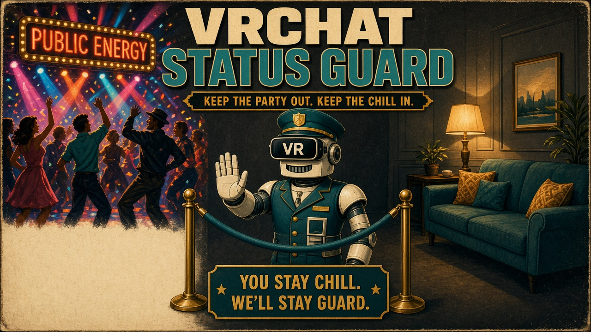

# VRChat Status Guard

[](https://github.com/introVRt-Lounge/vrchat-status-guard/actions/workflows/ci.yml)



## Does this actually work?

**Not reliably - and that is VRChat's fault, not a missing checkbox in this app.**

Status Guard writes Ask Me / Do Not Disturb / Join Me through the unofficial API. The website and tools like VRCX see that change. The **live game client often does not**: friends can still see Join Me and still get a Join path after the API already says otherwise. There is no OSC or supported local way to force the client.

Until VRChat makes API status changes update in-game joinability, **your mileage will vary** - not "may." Rely on this tool alone for privacy and you are setting yourself up for significant disappointment. Treat it as braces with **no belt**. Invite / Invite+ instances remain the hard door.

**Want this tool to actually work?** Go upvote and comment on VRChat's own report so they fix the platform:

→ [VRC Rest API / Websocket issues - Status and Avatar Changes Are Extremely Unreliable](https://feedback.vrchat.com/open-beta/p/vrc-rest-api-websocket-issues-since-years-status-and-avatar-changes-are-extremel)

## What it is

Unofficial Windows tray helper for PC VRChat. Mark worlds as protected; on enter it asks the API for Ask Me, Do Not Disturb, or (opt-in) Join Me, and can set group repping. Best-effort automation for when the client happens to listen.

Brought to you by the **[introVRt Lounge](https://vrchat.com/home/group/grp_481c4787-5fca-44b2-b6e4-d2d8c585f125)** - movies, games, and good company for fellow introverts. Discord: **[tiny.cc/introvrt](https://tiny.cc/introvrt)**. Site: [introvrtlounge.com](https://www.introvrtlounge.com/).

## Rate limit (Tupper)

Third-party apps must not hit the unofficial API more than **once per 60 seconds** (abuse can terminate accounts). We treat that as a hard budget for status and group mutations.

- Status may take **up to ~60s** after a recent mutation (or apply immediately if the budget is free).
- Status always before optional group repping; world hops coalesce to the latest join and cancel stale applies.
- Balloons mean the API write landed - not that the live client matched.
- No mutations while the VRChat process is not running.

Citations: [vrchatapi-csharp](https://github.com/vrchatapi/vrchatapi-csharp) · [specification](https://github.com/vrchatapi/specification) · [vrchatapi-python](https://github.com/vrchatapi/vrchatapi-python)

## Install

1. Download **Setup.exe** from the latest [GitHub Release](https://github.com/introVRt-Lounge/vrchat-status-guard/releases) (Velopack).
2. Tray → **Login…** (username/email, password, 2FA if prompted).
3. First-run wizard: protect one world (status required, group optional).
4. Tray: left-click pause/resume; double-click protection hub; right-click for activity log / updates / About.
5. Enter a protected world - API status (and optional group) apply when the budget allows.

Self-contained (.NET embedded). Cookies in DPAPI. `feat`/breaking merges cut a GitHub Release (Velopack); patch releases on demand via workflow_dispatch.

Maintainer local install (matches Startup Run key):

```powershell
.\scripts\deploy-local-install.ps1
.\scripts\build-velopack.ps1 -Version 0.2.0   # pack only
```

## Dev

```powershell
dotnet restore src/VrchatPrivacy.sln
dotnet test tests/VrchatPrivacy.Core.Tests/VrchatPrivacy.Core.Tests.csproj
dotnet run --project src/VrchatPrivacy.App/VrchatPrivacy.App.csproj
```

| Project | Role |
|---------|------|
| `VrchatPrivacy.Core` | Log parse, rules, auth, protection decisions |
| `VrchatPrivacy.App` | WinForms tray (Windows) |
| `VrchatPrivacy.Core.Tests` | Unit tests |

VRChat logs: `%UserProfile%\AppData\LocalLow\VRChat\VRChat\output_log_*.txt`.

## Hard constraints

- Match **world IDs** only.
- Do not invent blue / Join Me on leave; blue only when configured for that world.
- DPAPI for cookies; never log passwords, OTP, or tokens.
- ≤1 mutating request / 60s (see above).

## Docs / license

[BUILD_BRIEF](docs/BUILD_BRIEF.md) · [research](docs/research/vrchat-logs-and-api.md) · [CONTRIBUTING](CONTRIBUTING.md) · [TODO](TODO.md) · [MIT](LICENSE)

Unofficial - not affiliated with VRChat Inc.
